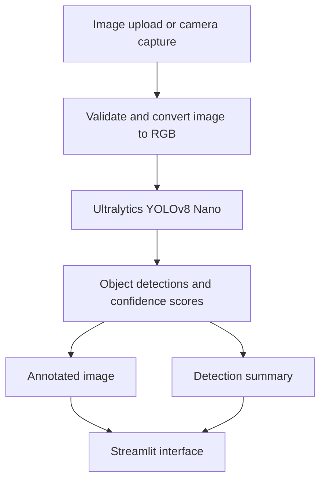

# YOLO Object Detection App

A small Streamlit computer-vision application that uses the Ultralytics YOLOv8 Nano model to detect objects in uploaded images or pictures captured with a device camera.

## Features

- Upload JPG, JPEG, PNG, or WebP images
- Capture a still image using the browser/device camera
- Adjust the confidence threshold
- View the annotated image and detected-object count
- See detected class names and confidence scores
- Cache the model between Streamlit reruns

> **Scope:** This repository currently provides image-based detection. It does not claim continuous live-webcam streaming or a custom-trained model. The pretrained `yolov8n.pt` weights are downloaded by Ultralytics when the app first runs.

## Architecture



## Requirements

- Python 3.10 or newer
- Internet connection for the initial YOLO model download

## Setup

### 1. Clone the repository

```bash
git clone https://github.com/alisafdarraza737-sketch/Task-3.Object-Detection-App.git
cd Task-3.Object-Detection-App
```

### 2. Create and activate a virtual environment

Windows PowerShell:

```powershell
python -m venv .venv
.venv\Scripts\Activate.ps1
```

macOS / Linux:

```bash
python3 -m venv .venv
source .venv/bin/activate
```

### 3. Install dependencies

```bash
python -m pip install --upgrade pip
pip install -r requirements.txt
```

### 4. Run the app

```bash
streamlit run app.py
```

Streamlit prints a local URL (normally `http://localhost:8501`) in your terminal.

## Project structure

```text
Task-3.Object-Detection-App/
├── app.py
├── requirements.txt
├── .gitignore
└── README.md
```

## Troubleshooting

- **First run is slow:** the pretrained YOLO weights may need to download.
- **Camera option is unavailable:** allow camera permission in your browser and use HTTPS or localhost.
- **Out of memory:** close other applications or use a smaller input image.
- **No detections:** try lowering the confidence threshold.

## Future improvements

- Add continuous webcam streaming with a dedicated video-stream component.
- Add batch image processing and downloadable detection reports.
- Add tests and a continuous-integration workflow.
- Add a deployment guide and a hosted demo.

## Author

**Ali Safdar Raza**

- GitHub: [@alisafdarraza737-sketch](https://github.com/alisafdarraza737-sketch)
- LinkedIn: [Ali Safdar Raza](https://www.linkedin.com/in/alisafdar-raza-07984b390/)

---

Built as a practical computer-vision project for learning and experimentation.
